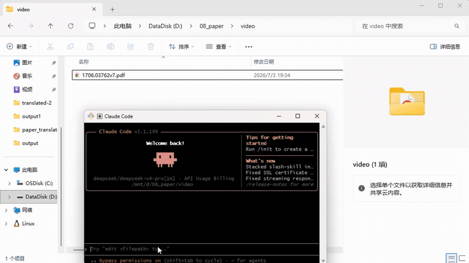

# pdf-translate

打开一篇英文论文，说一句「翻译」。

公式还在原来的位置，图还在原来的框里，页还是那一页。你会拿到一份能直接读的中文稿，和一份原文对照。

[](LICENSE)



它是给 **Claude Code、Grok、Codex、Cursor、Copilot、Gemini CLI、OpenCode、Qwen、Trae** 用的同一份技能：一份 `SKILL.md`，装进各家会找的那个文件夹。翻译走你已经登录的额度；没有 CLI 时，再用网关或免费通道。

---

## 开始

```bash
git clone https://github.com/yanxinwu946/pdf-translate.git
cd pdf-translate
bash install.sh          # macOS / Linux / Git Bash
# powershell -ExecutionPolicy Bypass -File .\install.ps1
```

或：

```bash
npx skills add yanxinwu946/pdf-translate
```

然后对你的 agent 说：

```
翻译这篇论文
```

需要 [uv](https://docs.astral.sh/uv/)。第一次会把排版模型带下来，之后都是本地缓存。

各家目录、手动拷贝、Windows 说明见 [`references/install.md`](references/install.md)。

---

## 你得到什么

- **中文版** `*-mono.pdf`
- **中英对照** `*-dual.pdf`
- 论文旁放一份 `pdf-translate-glossary.csv`，专名就会按你的写法走

默认英语 → 简体中文，也可以换成其他语言。

---

## 致谢

站在这些项目之上：

- [PDFMathTranslate](https://github.com/Byaidu/PDFMathTranslate)
- [BabelDOC](https://github.com/fky2015/babeldoc)
- [PDFMathTranslate-next](https://github.com/reycn/pdf2zh-next)
- [DocLayout-YOLO](https://github.com/opendatalab/DocLayout-YOLO)
- 原始技能 [L27z18328742/pdf-translate](https://github.com/L27z18328742/pdf-translate)

在那份技能之上，登录额度、术语表、各家 agent 一次能装上。

MIT License
