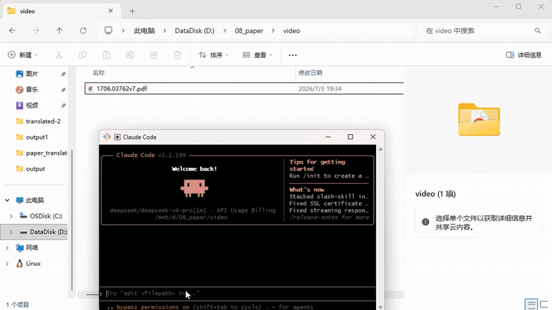

# pdf-translate

打开一篇英文论文，说一句「翻译」。

公式还在原来的位置，图还在原来的框里，页还是那一页。你会拿到一份能直接读的中文稿，和一份原文对照。

[](LICENSE)



当前会话直接翻译，原排版引擎负责把译文放回论文。不另启模型命令行，不需要翻译 API，也不转交其他厂商。

---

## 开始

```bash
git clone https://github.com/yanxinwu946/pdf-translate.git
cd pdf-translate
bash install.sh          # macOS / Linux / Git Bash
# powershell -ExecutionPolicy Bypass -File .\install.ps1
```

或：

```bash
npx skills add yanxinwu946/pdf-translate
```

然后对你的 agent 说：

```
翻译这篇论文
```

需要 [uv](https://docs.astral.sh/uv/)。第一次会把排版模型带下来，之后都是本地缓存。

默认安装到 `~/.codex/skills/pdf-translate`，已有安装不会被覆盖。Windows 使用 `install.ps1` 安装、Git Bash 运行排版脚本。当前会话需要持续处理译文队列，不是无人值守的一键翻译服务。

---

## 你得到什么

- **中文版** `*-mono.pdf`
- **中英对照** `*-dual.pdf`

默认英语 → 简体中文，也可以换成其他语言。

---

## 致谢

站在这些项目之上：

- [PDFMathTranslate](https://github.com/Byaidu/PDFMathTranslate)
- [BabelDOC](https://github.com/fky2015/babeldoc)
- [PDFMathTranslate-next](https://github.com/reycn/pdf2zh-next)
- [DocLayout-YOLO](https://github.com/opendatalab/DocLayout-YOLO)
- 原始技能 [L27z18328742/pdf-translate](https://github.com/L27z18328742/pdf-translate)

保留原来的排版能力，只让当前会话负责翻译。

MIT License
